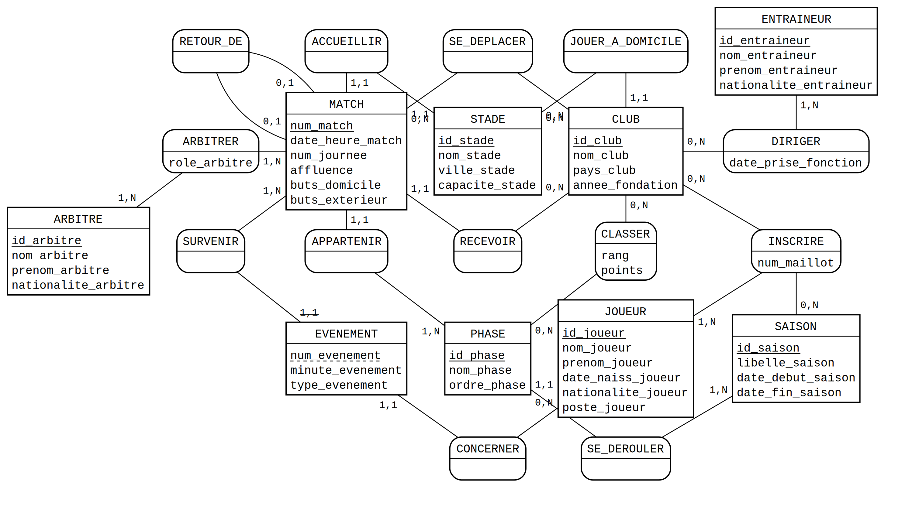

# Mini-projet Bases de données : Ligue des champions

Module TI503N, Bases de données 1.
Binôme : Raphaël Simon et Selim Rebai.

Ce dépôt contient la partie 1 du mini-projet, donc l'analyse des besoins et le MCD.

## Le domaine choisi

Une organisation qui gère une compétition européenne de clubs, comme l'UEFA avec la Ligue des champions. Elle inscrit les clubs qualifiés, construit le calendrier, découpe la saison en phases, programme les matchs, désigne les arbitres, enregistre les résultats et publie les classements.

Au départ on avait pris les trois compétitions européennes d'un coup : Ligue des champions, Ligue Europa, Ligue Conférence. Ça n'apportait rien. On se retrouvait avec une entité `COMPETITION` à trois lignes et des règles de gestion diluées, vu que les trois ne fonctionnent pas exactement pareil (le nombre de matchs en phase de ligue change par exemple). On a tout recentré sur la Ligue des champions, et là on a pu creuser beaucoup plus le déroulement sportif.

Les deux sites qu'on a utilisés : https://fr.uefa.com/uefachampionsleague/ pour la compétition elle-même, et https://fr.uefa.com/insideuefa/ pour le fonctionnement de l'organisation.

## Étape 1 : analyse des besoins

### Le prompt

On a repris la base fournie avec le sujet sans toucher à sa structure, en remplissant juste les `[A COMPLETER]`. Il est aussi dans `prompt.txt`.

> Tu travailles dans le domaine de l'organisation de compétitions de football de clubs au niveau continental. Ton organisation a comme activité d'organiser et de gérer une seule compétition, la Ligue des champions : elle inscrit les clubs qualifiés, construit le calendrier, découpe la saison en phases successives, programme et supervise les matchs, désigne les arbitres, enregistre les résultats et publie les classements. C'est une organisation comme l'UEFA, la CONMEBOL, l'AFC ou la FIFA. Les données ont été collectées sur les saisons, les phases de la compétition, les clubs engagés, les stades, les joueurs inscrits, les entraîneurs, les matchs, les arbitres, les événements de jeu (buts et cartons) et les classements. Inspire-toi des sites web suivants : https://fr.uefa.com/uefachampionsleague/ et https://fr.uefa.com/insideuefa/.
>
> Ton organisation veut appliquer MERISE pour concevoir un système d'information. Tu es chargé de la partie analyse, c'est-à-dire de collecter les besoins auprès de l'entreprise. Elle a fait appel à un étudiant en ingénierie informatique pour réaliser ce projet, tu dois lui fournir les informations nécessaires pour qu'il applique ensuite lui-même les étapes suivantes de conception et développement de la base de données.
>
> D'abord, établis les règles de gestion des données de ton organisation, sous la forme d'une liste à puce. Elle doit correspondre aux informations que fournit quelqu'un qui connaît le fonctionnement de l'entreprise, mais pas comment se construit un système d'information.
>
> Ensuite, à partir de ces règles, fournis un dictionnaire de données brutes avec les colonnes suivantes, regroupées dans un tableau : signification de la donnée, type, taille en nombre de caractères ou de chiffres. Il doit y avoir entre 25 et 35 données. Il sert à fournir des informations supplémentaires sur chaque donnée (taille et type) mais sans a priori sur comment les données vont être modélisées ensuite.
>
> Fournis donc les règles de gestion et le dictionnaire de données.

### Où on a placé les 7 éléments de RICARDO

**Rôle.** Première phrase, "Tu travailles dans le domaine de l'organisation de compétitions de football de clubs au niveau continental", complétée plus loin par "Tu es chargé de la partie analyse". On voulait que l'IA incarne le métier et pas l'informaticien, sinon elle part direct sur des tables et des clés.

**Instructions.** Les deux étapes introduites par "D'abord" et "Ensuite". On a tenu à écrire "à partir de ces règles" : sans ça on obtenait deux blocs qui ne se parlaient pas du tout.

**Contexte.** Fin du premier paragraphe et tout le deuxième. L'activité détaillée, le fait qu'il n'y ait qu'une compétition, les sujets sur lesquels les données ont été collectées, et le fait qu'un étudiant reprenne derrière avec MERISE.

**Contraintes.** Quatre, sur les deux derniers paragraphes. Les deux évidentes d'abord, le nombre de données entre 25 et 35 et la liste à puce. Mais les deux vraiment utiles sont celles qui portent sur le registre : "quelqu'un qui connaît le fonctionnement de l'entreprise, mais pas comment se construit un système d'information" empêche l'IA de répondre en vocabulaire de modélisation, et "sans a priori sur comment les données vont être modélisées ensuite" l'empêche de glisser des identifiants techniques dans le dictionnaire.

**Références.** Les deux liens UEFA à la fin du premier paragraphe.

**Rendement désiré.** Imposé deux fois, une par livrable : liste à puce pour les règles, tableau à trois colonnes nommées pour le dictionnaire.

**Objectif.** La dernière phrase, "Fournis donc les règles de gestion et le dictionnaire de données", qu'on avait déjà annoncée en disant que l'étudiant devait pouvoir continuer seul.

### Ce qu'on a vérifié dans la réponse

On a repris le résultat ligne par ligne. Dans l'ensemble ça tenait : 35 données donc dans la fourchette, les trois colonnes demandées, des règles rédigées côté métier sans jamais parler d'entité ni de cardinalité, et aucun identifiant technique dans le dictionnaire. C'était la contrainte la plus facile à rater, donc on a vérifié celle-là en premier.

On a quand même dû tout resoumettre une fois. La première version portait sur les trois compétitions et le résultat partait dans tous les sens, avec des règles valables pour l'une mais pas pour les autres. On en a profité pour ajouter au contexte que l'organisation inscrit les clubs qualifiés et désigne les arbitres : sans ça on n'obtenait rien sur les listes de joueurs ni sur les rôles d'arbitrage, alors que c'est justement ce qui rend le modèle intéressant.

Deux choix du dictionnaire sur lesquels on a hésité. La minute de jeu est sur 3 chiffres et pas 2, pour aller jusqu'à la 120e en prolongation. Et le rang et les points sont là alors qu'on pourrait les recalculer depuis les matchs, mais l'organisation les publie officiellement donc ils font partie de ses données.

### Règles de gestion

**Saison et phases**

- L'organisation gère une seule compétition, la Ligue des champions, qui se dispute une fois par saison.
- Une saison s'écrit sous la forme "2026/27" et a une date de début et une date de fin.
- Une saison se découpe en plusieurs phases qui se suivent dans un ordre fixé : tours de qualification, barrages, phase de ligue, barrages à élimination directe, huitièmes, quarts, demi-finales, finale.
- La phase de ligue réunit 36 clubs, et chaque club y joue 8 matchs répartis en journées numérotées de 1 à 8.

**Clubs et stades**

- Un club a un nom, appartient à un pays et a une année de fondation.
- Un club joue ses matchs à domicile dans son stade habituel.
- Plusieurs clubs peuvent partager le même stade. L'AC Milan et l'Inter jouent tous les deux à San Siro.
- Un stade a un nom, se situe dans une ville et a une capacité en nombre de places.
- Un club peut jouer dans un autre stade que le sien, en cas de travaux ou de sanction par exemple.
- La finale se joue dans un stade désigné à l'avance, quels que soient les clubs qualifiés.

**Joueurs et entraîneurs**

- Chaque saison, un club inscrit une liste de joueurs pour la compétition.
- Un joueur a un nom, un prénom, une date de naissance, une nationalité et un poste parmi gardien, défenseur, milieu ou attaquant.
- Un joueur porte un numéro de maillot dans son club pour une saison donnée. Ce numéro peut changer d'une saison à l'autre, en général quand il change de club.
- Un joueur peut changer de club d'une saison à l'autre, mais sur une saison donnée il n'est inscrit que pour un seul club.
- Un club a un seul entraîneur principal à un moment donné, et on garde la date à laquelle il a pris ses fonctions.
- Un entraîneur a un nom, un prénom et une nationalité. Il peut entraîner plusieurs clubs dans sa carrière, y compris pendant une même saison s'il est remplacé en cours d'année.

**Matchs**

- Chaque match porte un numéro qui l'identifie.
- Un match oppose un club qui reçoit et un club qui se déplace, à une date et une heure données, dans un stade donné.
- Un match appartient à une seule phase. S'il relève de la phase de ligue, il porte en plus un numéro de journée.
- Pour chaque match on enregistre le nombre de buts de chaque club et l'affluence, c'est-à-dire le nombre de spectateurs.
- Dans les phases à élimination directe les clubs s'affrontent en aller puis en retour, et chaque match retour est rattaché à son aller.
- La finale fait exception, elle se joue en un seul match.

**Arbitres**

- Chaque match est dirigé par une équipe d'arbitres : un arbitre central, deux assistants, un quatrième arbitre et des arbitres vidéo.
- Un arbitre a un nom, un prénom et une nationalité.
- Un même arbitre officie sur beaucoup de matchs, et son rôle peut changer d'un match à l'autre.
- Un arbitre ne peut pas être désigné sur un match qui implique un club de son propre pays.

**Événements de jeu**

- Pendant un match on enregistre les faits marquants, les buts et les cartons.
- Chaque événement se rapporte à un joueur, survient à une minute précise et a un type : but en action de jeu, but sur penalty, but sur coup franc, but contre son camp, carton jaune, carton rouge.
- Un événement n'a pas de sens en dehors de son match. Dire "73e minute, carton jaune" ne désigne rien tant qu'on ne précise pas de quel match on parle.
- Un but contre son camp est compté pour le club adverse.
- Deux cartons jaunes reçus par un même joueur dans un même match entraînent un carton rouge.

**Classements**

- Un classement est publié pour la phase de ligue.
- Pour chaque club le classement donne son rang et son nombre de points.
- Une victoire rapporte 3 points, un nul 1 point, une défaite 0.
- Les 8 premiers sont qualifiés directement pour les huitièmes.
- Les clubs classés de la 9e à la 24e place jouent les barrages.
- Les clubs classés de la 25e à la 36e place sont éliminés.

### Dictionnaire de données

A pour alphabétique, AN pour alphanumérique, N pour numérique, D pour une date (JJ/MM/AAAA), DH pour une date et heure (JJ/MM/AAAA HH:MM).

| N° | Signification de la donnée | Type | Taille |
|:--:|---|:--:|:--:|
| 1 | Libellé de la saison (ex. 2026/27) | AN | 7 |
| 2 | Date de début de la saison | D | 10 |
| 3 | Date de fin de la saison | D | 10 |
| 4 | Nom de la phase | AN | 40 |
| 5 | Ordre de la phase dans la saison | N | 2 |
| 6 | Nom du club | AN | 50 |
| 7 | Pays du club | A | 40 |
| 8 | Année de fondation du club | N | 4 |
| 9 | Nom du stade | AN | 60 |
| 10 | Ville du stade | A | 40 |
| 11 | Capacité du stade en nombre de places | N | 6 |
| 12 | Nom du joueur | A | 40 |
| 13 | Prénom du joueur | A | 40 |
| 14 | Date de naissance du joueur | D | 10 |
| 15 | Nationalité du joueur | A | 40 |
| 16 | Poste du joueur | A | 20 |
| 17 | Numéro de maillot du joueur | N | 2 |
| 18 | Nom de l'entraîneur | A | 40 |
| 19 | Prénom de l'entraîneur | A | 40 |
| 20 | Nationalité de l'entraîneur | A | 40 |
| 21 | Date de prise de fonction de l'entraîneur | D | 10 |
| 22 | Numéro du match | N | 6 |
| 23 | Date et heure du coup d'envoi | DH | 16 |
| 24 | Numéro de la journée | N | 1 |
| 25 | Affluence du match en nombre de spectateurs | N | 6 |
| 26 | Nombre de buts du club qui reçoit | N | 2 |
| 27 | Nombre de buts du club qui se déplace | N | 2 |
| 28 | Nom de l'arbitre | A | 40 |
| 29 | Prénom de l'arbitre | A | 40 |
| 30 | Nationalité de l'arbitre | A | 40 |
| 31 | Rôle de l'arbitre sur le match | A | 30 |
| 32 | Minute de l'événement de jeu | N | 3 |
| 33 | Type de l'événement de jeu | A | 25 |
| 34 | Rang du club au classement | N | 2 |
| 35 | Nombre de points du club au classement | N | 2 |

35 données.

## Étape 2 : le MCD

Fait avec Mocodo. Le fichier source est `MCD_LDC.mcd`, et il y a aussi `MCD_LDC.pdf` pour l'impression.

### Les entités

9 entités : `SAISON`, `PHASE`, `MATCH`, `EVENEMENT`, `CLUB`, `STADE`, `JOUEUR`, `ENTRAINEUR`, `ARBITRE`.

On a ajouté des identifiants techniques qui n'étaient pas dans le dictionnaire : `id_saison`, `id_phase`, `id_club`, `id_stade`, `id_joueur`, `id_entraineur`, `id_arbitre`. Le sujet autorise d'ajouter des données, et c'était nécessaire parce qu'aucune donnée métier ne garantit l'unicité. Deux joueurs peuvent être homonymes et nés le même jour, deux stades peuvent porter le même nom dans deux villes différentes. Le seul identifiant qu'on a gardé du dictionnaire est `num_match`.

### Les associations

13 en tout.

Les plus simples relient deux entités sans rien porter : `SE_DEROULER` entre la saison et ses phases (1,N et 1,1), `APPARTENIR` entre une phase et ses matchs (1,N et 1,1), `ACCUEILLIR` entre un stade et les matchs qui s'y jouent (0,N et 1,1), `JOUER_A_DOMICILE` entre un stade et les clubs qui y résident (0,N et 1,1), `CONCERNER` entre un joueur et les événements qui le concernent (0,N et 1,1).

`RECEVOIR` et `SE_DEPLACER` relient toutes les deux un club à un match, en 0,N et 1,1. On s'est demandé s'il ne valait pas mieux n'en faire qu'une. On a gardé les deux parce que le rôle domicile ou extérieur porte du sens : c'est lui qui dit lequel des deux scores est `buts_domicile`.

Quatre associations portent des données. `INSCRIRE` relie `JOUEUR` (1,N), `CLUB` (0,N) et `SAISON` (0,N), avec `num_maillot`. `ARBITRER` relie `ARBITRE` et `MATCH`, tous les deux en 1,N, avec `role_arbitre`. `DIRIGER` relie `ENTRAINEUR` (1,N) et `CLUB` (0,N), avec `date_prise_fonction`. `CLASSER` relie `CLUB` et `PHASE`, tous les deux en 0,N, avec `rang` et `points`.

Restent `SURVENIR` et `RETOUR_DE`, détaillées juste en dessous.

### Les éléments de modélisation avancée

Le sujet en demande au moins deux. On en a trois.

**L'association ternaire `INSCRIRE`**

Elle relie `JOUEUR`, `CLUB` et `SAISON` en même temps, et porte le numéro de maillot.

Impossible de la découper en associations binaires, parce que le numéro de maillot ne dépend d'aucune des trois entités prise seule. Pas du joueur : Mbappé portait le 7 au PSG et le 9 au Real. Pas du club : le 10 du Real change de titulaire d'une saison à l'autre. Et pas de la saison, évidemment. Le numéro appartient au triplet entier, ce qui est le cas d'usage type d'une ternaire porteuse de données.

**L'entité faible `EVENEMENT`**

`EVENEMENT` est identifiée relativement à `MATCH`, par l'association `SURVENIR`. `MATCH` est donc l'entité forte.

La raison est métier. Un but ou un carton n'existe pas en dehors du match où il a été marqué. Et la minute plus le type ne suffisent pas à distinguer deux événements, vu que deux cartons jaunes peuvent tomber à la même minute dans le même match. L'identifiant complet, c'est le couple (`num_match`, `num_evenement`). Sur le schéma, `num_evenement` est souligné en pointillés, c'est la notation Mocodo de l'identifiant relatif, et la patte côté `EVENEMENT` porte (1,1).

Ce choix a réglé un autre problème au passage. On était partis sur deux entités séparées, `BUT` et `CARTON`, qui se retrouvaient avec exactement les mêmes attributs. En les regroupant dans `EVENEMENT` avec un `type_evenement`, la duplication disparaît.

**L'association récursive `RETOUR_DE`**

Elle relie `MATCH` à lui-même, 0,1 de chaque côté. C'est le fonctionnement des phases à élimination directe : une confrontation se joue en aller puis en retour, et chaque retour est rattaché à son aller.

Les cardinalités minimales à 0 sont indispensables. Les matchs de phase de ligue et la finale ne font partie d'aucun couple aller-retour, ils doivent pouvoir rester seuls.

### Normalisation

Tous les attributs sont atomiques, nom et prénom séparés pour chaque personne, pas d'attribut multivalué ni répétitif. La 1FN est donc respectée.

Pour la 2FN, le seul identifiant composite du modèle est celui de `EVENEMENT`. Ses attributs `minute_evenement` et `type_evenement` dépendent bien du couple complet, pas du seul `num_match`. Pareil pour `num_maillot`, qui dépend du triplet entier de `INSCRIRE`.

Pas de dépendance transitive non plus. Le point sensible, c'était la ville : on l'a mise dans `STADE` et pas dans `CLUB`, sinon on créait la chaîne `id_club` vers `id_stade` vers `ville_stade`. Même logique pour la nationalité, qui est propre à chaque personne et jamais déduite d'autre chose.

Il reste deux points dénormalisés exprès. `buts_domicile` et `buts_exterieur` sont dans `MATCH` alors qu'on pourrait les recompter à partir des événements de type but, mais ils correspondent au score officiel homologué, qui fait foi même si un événement n'a pas été saisi. Même raisonnement pour `rang` et `points` dans `CLASSER`.

### Les 35 données du dictionnaire dans le MCD

Elles y sont toutes. Les données 1 à 3 dans `SAISON`, 4 et 5 dans `PHASE`, 6 à 8 dans `CLUB`, 9 à 11 dans `STADE`, 12 à 16 dans `JOUEUR`, 18 à 20 dans `ENTRAINEUR`, 22 à 27 dans `MATCH`, 28 à 30 dans `ARBITRE`, 32 et 33 dans `EVENEMENT`.

Les cinq qui restent sont portées par des associations : le numéro de maillot par `INSCRIRE`, la date de prise de fonction par `DIRIGER`, le rôle de l'arbitre par `ARBITRER`, le rang et les points par `CLASSER`.

### Ce que le MCD ne peut pas exprimer

Certaines règles ne se traduisent pas en entité-association. On les note pour les reprendre en contraintes SQL à l'étape 3 :

- le club qui reçoit doit être différent de celui qui se déplace
- un arbitre ne peut pas être désigné sur un match impliquant un club de sa nationalité
- `num_journee` n'est renseigné que pour la phase de ligue, avec une valeur de 1 à 8
- sur une saison donnée, un joueur ne peut être inscrit que pour un seul club
- `minute_evenement` est comprise entre 1 et 120
- `type_evenement` appartient à une liste fermée
- un match ne peut pas être son propre match retour
- `points` vaut 3 fois le nombre de victoires plus le nombre de nuls

## Contenu du dépôt

- `README.md` : ce fichier
- `prompt.txt` : le prompt soumis à l'IA et la correspondance RICARDO
- `MCD_LDC.mcd` : le fichier source du MCD, format Mocodo
- `MCD_LDC.png` : l'image du MCD utilisée plus haut
- `MCD_LDC.pdf` : le MCD en version imprimable
